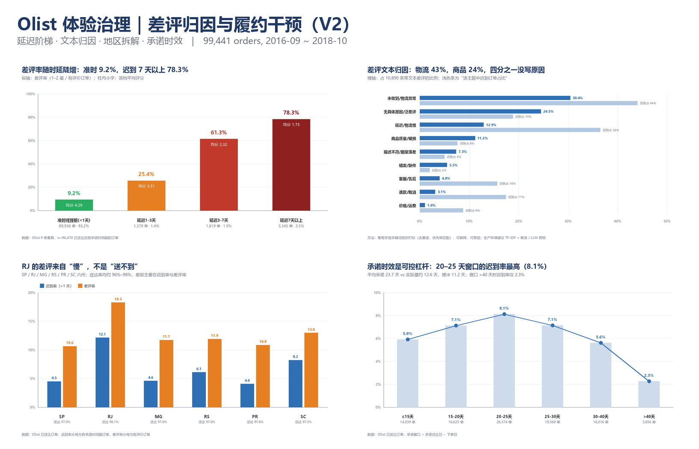

# Olist Experience Governance: Review Attribution & Delivery Intervention

**Why do 5% of orders produce 28% of the bad reviews — and what can be fixed before delivery, not after?**


[](https://public.tableau.com/views/Olist_17945512696070/1)

*Live Tableau dashboard (three latency buckets: 4.29 / 3.29 / 1.86 — the same definition used throughout this repository).*

**Links:** [Live dashboard](https://public.tableau.com/app/profile/43153393) · [Full report (PDF)](report/Olist电商体验治理分析报告_V2.pdf) · [Raw data (Kaggle)](https://www.kaggle.com/datasets/olistbr/brazilian-ecommerce)

---

## TL;DR

| # | Finding | Evidence |
|---|---|---|
| 1 | **5% of orders generate 28% of the bad reviews.** Lateness is the largest controllable lever. | Orders ≥4 days late are 4.8% of the base but 27.7% of all 1–2★ reviews; bad-review rate **62.3%** for late orders (>1 day) vs **9.2%** on time (6.8×) |
| 2 | **The effect survives controls.** It is not a seller-mix or category-mix artefact. | Within-seller: **54/54** sellers worse, **+53.2pp**; within-category: **29/29**, **+51.7pp** |
| 3 | **But lateness explains only ~28% of bad reviews.** | PAF = **27.6%**; text attribution: logistics **43.3%**, product **24.0%**, service/refund **8.2%**, no reason given **24.5%** |
| 4 | **RJ is slow, not undelivered.** The fix is lead time, not delivery rate. | RJ delivered **96.1%** vs SP **97.0%**, but late **12.1%** vs **4.5%**; **60%** of the RJ–SP review gap is explained by the late rate |
| 5 | **The promise date is the cheapest lever.** | Promise **23.7 days** vs actual **12.6 days** (11.2-day buffer); late rate peaks at **8.1%** in the 20–25-day window |
| 6 | **Do not sell this as a retention story.** | First-order late vs on-time repeat rate: **3.45% vs 3.17%** (n=6,405 / 86,951) — no detectable penalty |

**So what:** a small, identifiable slice of orders — largely predictable from seller history and the promised window — drives a disproportionate share of negative experience. The viable play is narrower and cheaper than "improve delivery": calibrate promises, fix RJ lead time, and govern a short seller list.

---

## What this project answers

Marketplace experience teams usually get descriptive dashboards ("orders by state"). This project works backwards from the negative signal — 1–2★ reviews — to the operational levers that produce it, and then tests whether those levers survive controls:

1. **Where does the negative experience come from?** Delay ladder, seller/category controls, review-text topics.
2. **How much of it can we actually attribute?** Contribution rate and population attributable fraction (PAF).
3. **What should we do on Monday?** RJ lead time, promise-window calibration, 6 high-risk sellers, product-side themes.
4. **How would we know it worked?** A/B design with guardrail metrics and sample-size maths.

---

## Data

- **Source:** [Brazilian E-Commerce Public Dataset by Olist](https://www.kaggle.com/datasets/olistbr/brazilian-ecommerce) (Kaggle, public, CC BY-NC-SA 4.0).
- **Scope:** 2016-09 to 2018-10, **9 tables, 1,550,922 rows, 99,441 orders**.
- **Grain:** one row per order in the analytical layer. Items and reviews are aggregated to one row per order **before** any join, which avoids the row-multiplication that makes naive "order counts" wrong in this dataset.

Raw CSVs are **not committed** — download them from Kaggle into `sql/olist_data/`. Only derived summary files live in `data/`.

---

## Method

1. **Load** — 9 CSVs → MySQL 8.0 via Python (`pandas` + `SQLAlchemy`), dates cast to `DATETIME`.
2. **Model** — order-level wide table `wide_orders` (**99,441 × 27**). `review_dedup` and `item_agg` are built first, then joined.
3. **Analyse** — two SQL layers:
   - `03_dashboard_queries_mysql.sql` — one query per dashboard sheet (5 KPI cards + 6 charts), "all orders" scope.
   - `04_governance_queries_mysql.sql` — "delivered only" scope: controls, PAF, RJ decomposition, promise window, seller risk rule, review-text topics.
4. **Visualise** — Tableau Public: 5 KPI cards, 6 charts, insight panel.
5. **Attribute the text** — 41.3% of reviews carry a comment (Portuguese). `05_text_topics.py` tags the 10,890 bad reviews into 9 business themes.

---

## Key findings

### 1. The delay ladder has two jumps, not one

| Bucket | Orders | Share | Avg score | Bad-review rate |
|---|---:|---:|---:|---:|
| On time / early (<1 day) | 89,936 | 93.2% | 4.29 | 9.2% |
| Late 1–4 days | 1,870 | 1.9% | 3.29 | 32.1% |
| Late ≥4 days | 4,664 | 4.8% | 1.86 | 74.7% |

The tolerance threshold sits at **1 day** (9.2% → 32.1%); beyond 4 days a bad review is close to certain. These are the same three buckets the dashboard uses.

### 2. The effect survives seller and category controls

- Within-seller (54 sellers with ≥20 late and ≥20 on-time orders): **54/54 worse**, mean **+53.2pp**.
- Within-category (29 categories with ≥30 orders each side): **29/29 worse**, mean **+51.7pp**.
- Unconditional gap: +53.1pp. Controls barely move it — the result is not a mix artefact.

### 3. Attribution, not storytelling

Late orders (>1 day) are 6.8% of the base, produce **32.5%** of bad reviews, and the PAF is **27.6%**. That makes lateness the **largest single controllable driver** — not "most of the problem". Review text shows the rest:

| Theme | Share | Of which late |
|---|---:|---:|
| Not received / logistics incident | 30.4% | 44% |
| No specific reason | 24.5% | 19% |
| Slow delivery | 12.9% | 36% |
| Product quality / damaged | 11.2% | 8% |
| Description mismatch | 7.3% | 5% |
| Wrong / missing item | 5.5% | 2% |
| Customer service | 4.0% | 16% |
| Refund / cancellation | 3.1% | 17% |
| Price / freight | 1.0% | 9% |

**59%** of bad reviews with text come from orders still inside the promised window — customers complain before the promise expires. That is direct evidence that the promise itself is too generous.

### 4. RJ: slow, not undelivered

| | SP | RJ |
|---|---:|---:|
| Orders | 41,746 | 12,852 |
| Delivery rate | 97.0% | 96.1% |
| Late rate (>1 day) | 4.5% | 12.1% |
| Avg fulfilment | 8.8 days | 15.3 days |
| Bad-review rate | 10.6% | 18.3% |

Decomposition of the 7.6pp gap: **4.6pp (60%)** from the late-rate difference, **3.0pp** from RJ being worse even at the same lateness. The target should be "RJ late rate 12.1% → ~5%", not "RJ delivery rate 96% → 98%".

### 5. The promise buffer is the cheap lever

Promise 23.7 days, actual 12.6 days, buffer 11.2 days. Late rate by promise window: 5.9% (≤15d), 7.1%, **8.1% (20–25d)**, 7.1%, 5.6%, **2.3% (>40d)**. The riskiest zone is where the promise is mis-calibrated against actual capability — not simply "longer is safer".

### 6. Two claims we deliberately dropped

- "6.8% of orders explain **most** bad reviews" → they explain **~28%**.
- "One late delivery loses the customer" → repeat rate is 3.45% (late) vs 3.17% (on time); no detectable penalty. With 96.9% one-time buyers, retention is not measurable from this dataset.

---

## Metric conventions

| Metric | Definition | Value |
|---|---|---|
| Delivered | `order_status = 'delivered'` | 96,478 (97.02%) |
| Bad review | score 1–2; denominator = reviewed orders | 12.8% (delivered) / 14.7% (all) |
| Late (`is_late_1d`) | delivered **>1 day** after the promise | 6,534 (6.8%) |
| Late (`is_late`) | delivered **after** the promise (any delay) | 7,826 (8.1%) |
| Fulfilment | delivered − purchase | 12.56 days |
| Seller shipping | carrier − purchase | 3.23 days |
| Promise window / buffer | promise − purchase / window − fulfilment | 23.74 / 11.18 days |
| GMV | product value (excl. freight) | R$ 13.59M (with freight 15.84M) |
| Avg review score | all reviews / delivered only | 4.09 / 4.16 |

Two definitions of "late" both exist in the repo and **must not be mixed**: `is_late` (>0 days, 8.1%) is the raw column; `is_late_1d` (>1 day, 6.8%) is the reported one, added by `02b_patch_is_late_1d.sql`. The report uses `is_late_1d` throughout.

---

## Repository structure

```
.
├── README.md
├── sql/
│   ├── 01_load_olist_mysql.py          # CSV → MySQL (credentials via env vars)
│   ├── 02_build_wide_table_mysql.sql   # order-level wide table + indexes
│   ├── 02b_patch_is_late_1d.sql        # adds the reported "late" definition
│   ├── 03_dashboard_queries_mysql.sql  # one query per dashboard sheet
│   ├── 04_governance_queries_mysql.sql # controls, PAF, RJ, promise, risk rule, topics
│   └── 05_text_topics.py               # Portuguese review-text tagging
├── analysis/
│   ├── compute_all.py                  # recompute every number in the report
│   ├── addendum.py                     # text attribution + timing cross-tabs
│   ├── make_charts.py                  # five report figures
│   └── build_report.py                 # assemble the DOCX report
├── data/
│   ├── kpi_summary.csv
│   ├── monthly_summary.csv
│   └── customer_frequency.csv
├── images/
│   └── dashboard.png
└── report/
    └── Olist电商体验治理分析报告_V2.pdf
```

The Tableau workbook is not committed (it embeds a 15MB extract); the public dashboard is linked at the top.

---

## Reproduce

```bash
# 0) dependencies
pip install pandas sqlalchemy pymysql cryptography

# 1) download the 9 CSVs from Kaggle into sql/olist_data/

# 2) credentials (never hard-code them)
export MYSQL_HOST=127.0.0.1
export MYSQL_PORT=3306
export MYSQL_USER=root
export MYSQL_PASSWORD=your_password
export MYSQL_DB=olist

# 3) load + build + analyse
python sql/01_load_olist_mysql.py
mysql -u "$MYSQL_USER" -p olist < sql/02_build_wide_table_mysql.sql
mysql -u "$MYSQL_USER" -p olist < sql/02b_patch_is_late_1d.sql
mysql -u "$MYSQL_USER" -p olist < sql/03_dashboard_queries_mysql.sql
mysql -u "$MYSQL_USER" -p olist < sql/04_governance_queries_mysql.sql
python sql/05_text_topics.py
```

Expected checkpoints: `total_orders = 99,441`; `delivery_rate = 0.9702`; `late_rate_1d = 0.0678`; `avg_review_score = 4.09`.

On Windows PowerShell use `$env:MYSQL_PASSWORD="..."` instead of `export`.

---

## What changed in V2

- Delay buckets kept at **three** (4.29 / 3.29 / 1.86), matching the dashboard; report, SQL and dashboard now share one definition.
- SP / RJ delivery rates corrected to **97.0% / 96.1%** (previously 97.6% / 94.7%, not reproducible from raw data).
- Added: seller and category controls, PAF, RJ decomposition, promise-window analysis, review-text attribution, seller risk rule.
- Replaced the unsupported "most bad reviews" and "late delivery kills retention" claims with tested statements.
- Report rebuilt as an A4, 12-page document with 5 figures and page numbers.

---

## Limitations

- Observational data. Seller/category controls remove the main confounders, not all of them (distance, carrier, time-of-day).
- Review comments are short Portuguese text; rule tagging is explainable but imperfect, and 24.5% of bad reviews give no reason.
- No returns, customer-service tickets, or traffic data — CLV and search-weight effects are out of scope.
- Multi-review orders keep the highest score (547 orders); impact on the bad-review rate is ~0.1pp.
- Single platform, single market (Brazil, 2016–2018). Re-validate before transferring.

---

## Data license

Dataset © Olist, distributed on Kaggle under **CC BY-NC-SA 4.0**. This repository contains derived aggregates and analysis code only; raw CSVs are not redistributed.

## Contact

Li Zhihao — [Tableau Public](https://public.tableau.com/app/profile/43153393)


